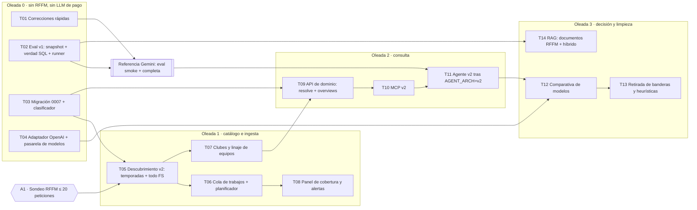

# Futsito v2 — Plan de ejecución

Estado: **diseño, sin implementar**. Base: auditoría del 2026-11-08 (commit `7eda656`) y decisiones del responsable
del proyecto de la misma fecha. Nada de este directorio cambia el comportamiento actual.

| Documento | Contenido |
|---|---|
| [data-model.md](data-model.md) | Catálogo estructurado, clasificación con confianza, identidad de club/equipo, multi-federación, migración 0007 |
| [ingestion.md](ingestion.md) | Descubrimiento automático, cola de trabajos, planificador por calendario (fin de semana), checkpoints, cobertura y alertas |
| [agent.md](agent.md) | Resolutor obligatorio, herramientas MCP v2 de alto nivel, niveles T0/T1/T2, pasarela de modelos, retirada de banderas |
| [evaluation.md](evaluation.md) | Batería Futsito-Eval v1, snapshot congelado, métricas, protocolo de comparación de modelos y presupuesto |
| [models.md](models.md) | Modelos verificados en documentación oficial (2026-11-08), precios, preselección y costes estimados |
| [delegation.md](delegation.md) | Fichas de tarea para Sonnet (contexto, archivos, contratos, aceptación, pruebas, Git) |
| [future-features.md](future-features.md) | Ideas de producto: seguimiento de mi equipo, entrenadores, árbitros, clubes, alertas |

## Decisiones ya tomadas (2026-11-08)

1. **Cobertura**: todo el fútbol sala de la RFFM (todas las categorías, divisiones, grupos, masculino y femenino si están en el
   catálogo, liga y copa). Temporada actual primero; histórico después. Sin lista manual de competiciones. El diseño admite
   otras federaciones en el futuro.
2. **Datos**: catálogo estructurado (temporada, modalidad, categoría, género, tipo, fase). **Nunca se asume senior**: lo no
   clasificable con confianza queda `unknown` y en revisión. Identidad de club y de equipo entre temporadas y grupos, mínima.
3. **Agente**: resolutor determinista obligatorio; el catálogo sale del system prompt; herramientas de alto nivel; retirada
   progresiva de heurísticas y banderas, siempre respaldada por pruebas.
4. **Evaluación antes de cambiar**: referencia objetiva y reproducible (precisión, críticos, llamadas, tokens, latencia, coste).
5. **Modelos**: Gemini es la referencia inicial (API gratuita), no una dependencia estratégica. Comparativa objetiva entre
   Google, Anthropic y OpenAI. Valorar multimodelo y modelos económicos para tareas sencillas.
6. **Ingesta**: descubrimiento automático, incremental, checkpoints, recuperación y cobertura. En producción se revisan los
   resultados varias veces al día, con mucha más frecuencia en la jornada del fin de semana en curso. Nueva temporada con
   intervención manual mínima.
7. **Trabajo**: Opus diseña, define contratos y acepta; Sonnet ejecuta tareas delimitadas. Sin grandes refactorizaciones
   que no se puedan validar.

## Principios de ejecución

- **Aditivo y en paralelo**: lo nuevo convive con lo actual (migraciones aditivas, herramientas v2 junto a las v1, agente v2
  tras `AGENT_ARCH=v2`). Lo antiguo se retira solo cuando la evaluación demuestra paridad o mejora.
- **Un dueño por archivo y por contrato** en cada oleada: dos tareas simultáneas nunca tocan el mismo archivo.
- **Sin red real en las pruebas**: fixtures grabadas; las peticiones a la RFFM y al LLM real solo con autorización explícita.
- **Medir antes de afirmar**: cada fase define su métrica de aceptación y la ejecuta.

## Grafo de dependencias

## Oleadas

| Oleada | Tareas (en paralelo dentro de la oleada) | Requiere | Salida verificable |
|---|---|---|---|
| **0** | T01 · T02 · T03 · T04 | Aprobación del esquema 0007 (A2) para T03 | Batería verde; snapshot reproducible; migración probada en PG desechable; adaptadores probados con HTTP simulado |
| **Referencia** | Ejecutar Eval v1 con Gemini (smoke y después completa) | T01, T02; autorización de uso de la clave (A3) | `eval-baseline-gemini-3.5-flash-lite` con IC por estrato |
| **1** | T05 → (T06 ∥ T07) → T08 | A1 (sondeo), A4 (ingesta real) | 100 % del catálogo FS clasificado o en revisión; reanudación sin pérdidas; cobertura medida |
| **2** | T09 → T10 → T11 | Oleada 1 en BD; referencia | Agente v2 ≥ referencia y con menos tokens y llamadas |
| **3** | T12 ∥ T14; después T13 | A5 (presupuesto de la comparativa) | Decisión de modelo con datos; banderas retiradas sin regresiones |
| **4** | Producción: autenticación, límites, persistencia, despliegue del planificador | A6, A7 | Servicio multiusuario |

Esfuerzo orientativo [E]: oleada 0 ≈ 1 semana; 1 ≈ 2 semanas; 2 ≈ 2–3 semanas; 3 ≈ 1–2 semanas. Depende de los
resultados del sondeo de la RFFM y de las cuotas del proveedor.

## Decisiones pendientes de aprobación

| Id | Decisión | Propuesta | Bloquea |
|---|---|---|---|
| **A1** | Sondeo de estructura de la RFFM (solo lectura, ≤ 20 peticiones, 5 s entre ellas): lista de temporadas, catálogo FS completo con `NombreCategoria`, códigos de club en escudos de dos temporadas | Sí | T05, T07 |
| **A2** | Esquema de la migración 0007 ([data-model.md](data-model.md)) | Aprobar tal cual | T03 |
| **A3** | Uso de la clave gratuita de Gemini para la referencia: smoke (≈ 40 preguntas) y después completa repartida en días según la cuota | Sí, con `--max-requests` | Referencia |
| **A4** | Ingesta real de todo el FS de la temporada actual (≈ estimación tras A1) | Tras revisar el plan de peticiones | Oleada 1 |
| **A5** | Presupuesto y preselección de la comparativa ([models.md](models.md)): fases F-A y F-B ≈ 35 USD con margen; F-C solo con una nueva aprobación | Ver preselección | T12 |
| **A6** | Dónde corre el planificador en producción (PC del usuario o VPS) | VPS pequeña (la frecuencia de fin de semana exige un proceso siempre encendido) | Oleada 4 |
| **A7** | Usuarios y autenticación (privado o público) | Privado por invitación al inicio | Oleada 4 |
| **A8** | Embeddings para el RAG híbrido (local o API) | Local multilingüe en CPU | T14 |
| **A9** | Datos personales de menores (jugadores de juvenil e inferiores) y de árbitros ([future-features.md](future-features.md) §Privacidad) | `aggregate_only` por defecto para juvenil e inferiores | exponer las actas de esas categorías (T09) |
